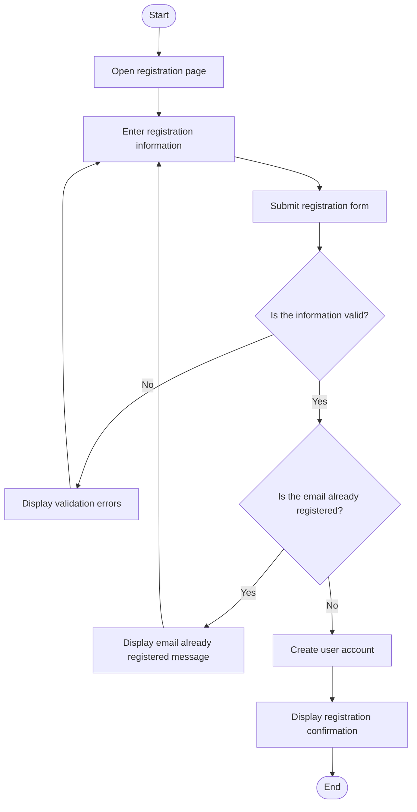
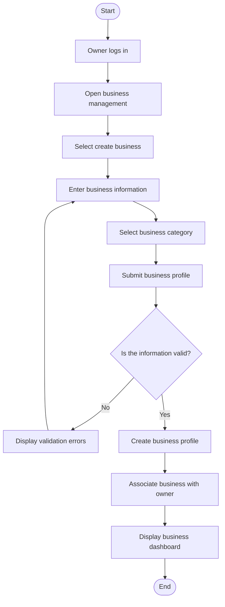
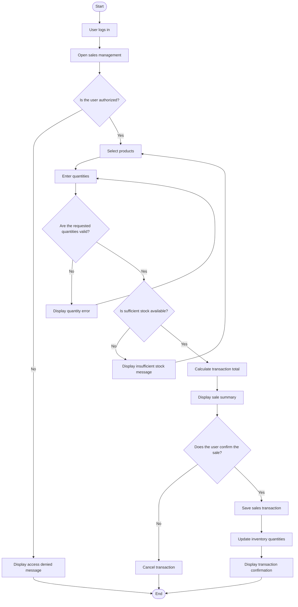

# SmallBiz IQ
## Activity Diagrams

**Document:** Activity Diagrams  
**Version:** 0.1  
**Status:** Initial Draft  
**Project Phase:** System Analysis

---

## 1. Introduction

This document presents activity diagrams for selected workflows within SmallBiz IQ.

Activity diagrams represent the sequence of activities, decisions, and alternative paths involved in a particular system operation.

They help describe how users interact with the system and how the system responds to their actions.

The workflows selected for this document are:

1. Business owner registration.
2. Business profile creation.
3. Recording a product sale.

These workflows represent important operations that will form part of the initial system implementation.

## 2. Business Owner Registration

### 2.1 Description

This activity diagram represents the process through which a new business owner creates an account in SmallBiz IQ.

The process includes entering registration information, validating the submitted data, and creating the account.

### 2.2 Activity Diagram

### 2.3 Workflow Explanation

1. The user opens the registration page.
2. The user enters the required information.
3. The system receives the registration form.
4. The system validates the submitted information.
5. If the information is invalid, an error message is displayed and the user can correct it.
6. If the information is valid, the system checks whether the email address is already registered.
7. If the email is already in use, the system displays an appropriate message.
8. Otherwise, the system creates the account and confirms successful registration.

**Postcondition:** A new user account is successfully created.

## 3. Business Profile Creation

### 3.1 Description

This activity diagram represents how an authenticated business owner creates a business profile.

The business profile stores the information needed to configure SmallBiz IQ for the owner's business.

### 3.2 Activity Diagram

### 3.3 Workflow Explanation

1. The business owner logs into SmallBiz IQ.
2. The owner opens the business management section.
3. The owner selects the option to create a business.
4. The system displays the business registration form.
5. The owner enters the business information and selects a category.
6. The system validates the submitted information.
7. If validation fails, the owner is asked to correct the information.
8. If validation succeeds, the system creates the business profile.
9. The system associates the business with the owner's account.
10. The owner is directed to the business dashboard.

**Postcondition:** A business profile is created and associated with its owner.

## 4. Recording a Product Sale

### 4.1 Description

This activity diagram represents how a business owner or authorized employee records a product sale.

The workflow includes product selection, quantity validation, total calculation, transaction confirmation, and inventory updates.

### 4.2 Activity Diagram

### 4.3 Workflow Explanation

1. The user logs into the application.
2. The user opens the sales management section.
3. The system checks whether the user has permission to record sales.
4. If the user is not authorized, access is denied.
5. If authorized, the user selects products and enters their quantities.
6. The system validates the requested quantities.
7. The system checks whether sufficient inventory is available.
8. If stock is insufficient, the system informs the user.
9. If the requested quantities are valid and available, the system calculates the transaction total.
10. The system displays a summary for confirmation.
11. If the user confirms, the transaction is saved and inventory quantities are updated.
12. The system displays a confirmation message.

**Postcondition:** The sale is recorded and the relevant inventory quantities are updated.

## 5. Activity Diagram Notation

The diagrams use the following symbols:

| Symbol | Meaning |
|---|---|
| Rounded start node | Beginning of an activity |
| Rounded end node | Completion of an activity |
| Rectangle | An action or operation |
| Diamond | A decision or condition |
| Arrow | Direction of workflow |
| Yes / No labels | Possible outcomes of a decision |

## 6. Conclusion

The activity diagrams describe the internal workflows of important SmallBiz IQ operations.

They demonstrate how users initiate operations, how the system validates information, how decisions affect the workflow, and how successful operations are completed.

These diagrams will help guide the implementation of application logic and the design of future sequence diagrams.