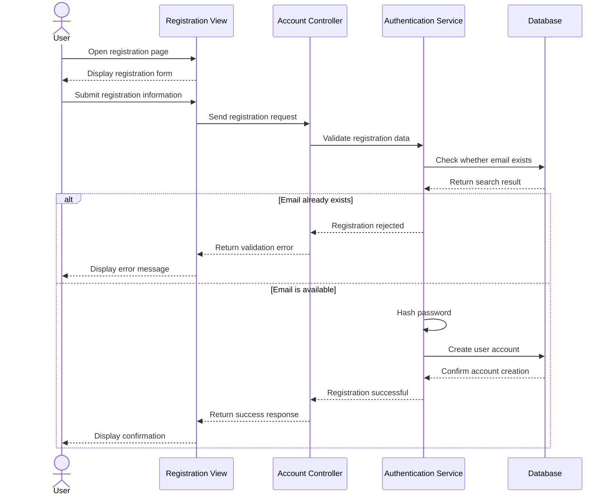
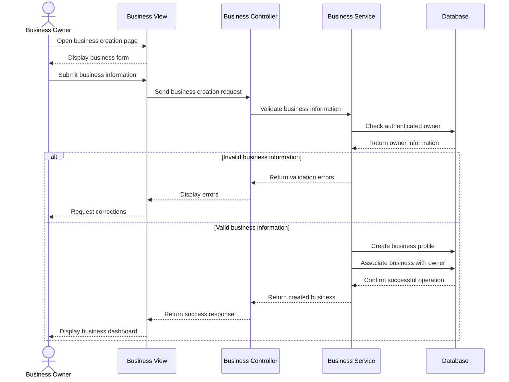
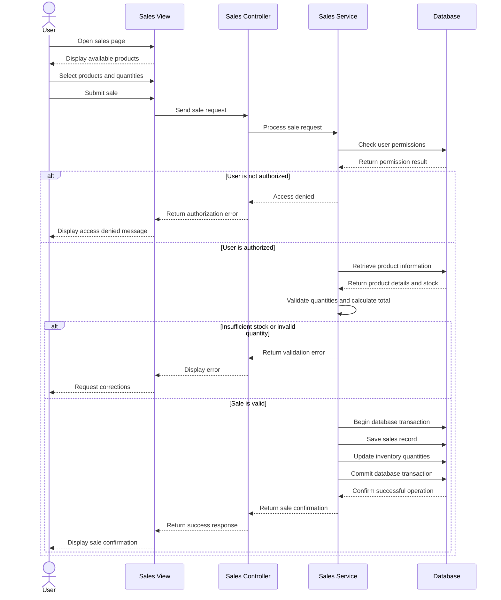

# SmallBiz IQ
## Sequence Diagrams

**Document:** Sequence Diagrams  
**Version:** 0.1  
**Status:** Initial Draft  
**Project Phase:** System Analysis

---

## 1. Introduction

This document presents sequence diagrams for selected operations within SmallBiz IQ.

A sequence diagram is a UML interaction diagram that illustrates how actors and system components communicate to complete a particular operation.

Unlike activity diagrams, which focus on workflows, sequence diagrams emphasize the order of messages exchanged between participants.

The diagrams in this document describe three important operations:

1. User registration.
2. Business profile creation.
3. Recording a product sale.

## 2. User Registration

### 2.1 Description

This sequence diagram illustrates how a new user registers an account.

The interaction involves the user, registration interface, account controller, authentication service, and database.

### 2.2 Sequence Diagram

### 2.3 Explanation

1. The user opens the registration page.
2. The registration view displays the required form.
3. The user submits their information.
4. The Account Controller receives the request.
5. The Authentication Service validates the information.
6. The service checks whether the email address already exists.
7. If the email is already registered, the system returns an error.
8. Otherwise, the password is securely hashed.
9. The database stores the new account.
10. A confirmation is returned to the user.

**Important:** Passwords must never be stored as plain text.

## 3. Business Profile Creation

### 3.1 Description

This diagram illustrates how an authenticated business owner creates a business profile.

The business profile is associated with the account of its owner.

### 3.2 Sequence Diagram

### 3.3 Explanation

1. The owner opens the business creation page.
2. The system displays the business information form.
3. The owner enters the required details and selects a business category.
4. The Business Controller receives the request.
5. The Business Service validates the submitted information.
6. The service verifies the authenticated owner.
7. If the information is valid, the service creates the business profile.
8. The database associates the new business with its owner.
9. The system confirms successful creation.

**Postcondition:** The business profile exists and is associated with the authenticated owner.

## 4. Recording a Product Sale

### 4.1 Description

This diagram illustrates how an authorized user records a product sale.

The operation involves authentication and permission checks, product validation, transaction calculations, and database updates.

### 4.2 Sequence Diagram

### 4.3 Explanation

1. The user opens the sales page.
2. The system displays the available products.
3. The user selects products and quantities.
4. The Sales Controller receives the request.
5. The Sales Service checks the user's permissions.
6. The service retrieves product information and available stock.
7. The service validates the requested quantities.
8. If the sale is invalid, an error is returned.
9. If the sale is valid, the system begins a database transaction.
10. The sales record is saved.
11. Inventory quantities are updated.
12. The transaction is committed.
13. The system returns confirmation to the user.

**Important technical consideration:**

The sales record and inventory update must be part of the same database transaction. If one operation fails, the transaction should be rolled back so that the database does not contain inconsistent information.

## 5. Sequence Diagram Notation

| Element | Meaning |
|---|---|
| Actor | External user interacting with the system |
| Participant | System component involved in the operation |
| Solid arrow | Message or request |
| Dashed arrow | Response or returned information |
| Activation | Period during which a participant performs an operation |
| `alt` | Alternative interaction paths |
| `else` | Another possible condition |
| `end` | End of an alternative interaction block |

## 6. Architectural Considerations

The sequence diagrams introduce the separation of responsibilities that will guide the implementation of SmallBiz IQ.

The planned architecture will distinguish between:

- **Presentation Layer:** Views and Controllers responsible for user interaction.
- **Business Logic Layer:** Services responsible for processing business rules.
- **Data Access Layer:** Components responsible for communication with the database.

This separation will help improve code organization, testability, maintainability, and future extensibility.

The exact implementation structure will be refined during system design.

## 7. Conclusion

The sequence diagrams describe how users and internal system components communicate during important SmallBiz IQ operations.

They provide a clearer understanding of the responsibilities of Controllers, Services, and database operations.

These interactions will guide the future implementation of the application using ASP.NET Core MVC, C#, and Entity Framework Core.