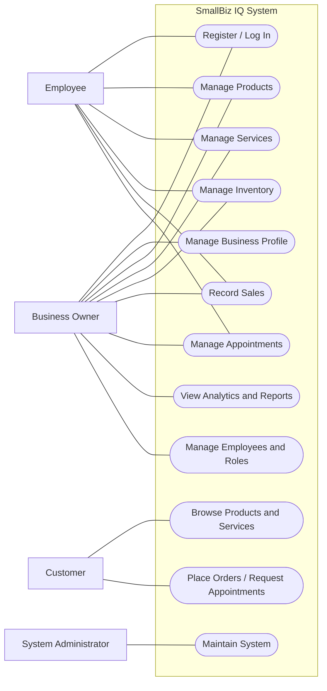

# SmallBiz IQ
## Use Case Analysis

**Document:** Use Case Analysis  
**Version:** 0.1  
**Status:** Initial Draft  
**Project Phase:** System Analysis

---

## 1. Introduction

This document identifies the actors who interact with SmallBiz IQ and describes the main use cases supported by the system.

A use case represents a specific interaction between an actor and the system to achieve a particular objective.

Use case analysis helps establish the functional boundaries of the application and provides a foundation for system design and implementation.

## 2. System Actors

The following actors have been identified:

### 2.1 Business Owner

The Business Owner is the primary actor responsible for creating and managing a business account.

Responsibilities include:

- Registering and accessing an account.
- Creating and managing a business profile.
- Managing products or services.
- Recording and monitoring business activities.
- Viewing analytics and reports.
- Inviting employees and assigning permissions.

### 2.2 Employee

An Employee is a user invited by a business owner to perform authorized operations.

Responsibilities may include:

- Accessing the assigned business.
- Recording sales.
- Managing product availability.
- Managing appointments.
- Recording completed services.

Employee activities depend on the permissions assigned by the business owner.

### 2.3 Customer

A Customer interacts with the customer-facing interface, which is planned for a future development stage.

Potential activities include:

- Browsing products and services.
- Viewing prices and descriptions.
- Checking availability.
- Placing orders or requesting appointments.

### 2.4 System Administrator

The System Administrator is responsible for technical administration and maintenance of the platform.

Responsibilities may include:

- Monitoring application operation.
- Managing system configuration.
- Handling technical issues.
- Supporting platform maintenance.

## 3. Use Case Diagram

The following diagram provides a high-level overview of how the actors interact with SmallBiz IQ.

**Diagram note:** This is a simplified use-case overview. The connections show potential interactions; actual employee access will depend on assigned permissions. Customer functionality is planned for a later release.

## 4. Use Case Catalogue

| Use Case ID | Use Case Name | Primary Actor |
|---|---|---|
| UC-01 | Register Account | Business Owner |
| UC-02 | Log In | All registered users |
| UC-03 | Create Business Profile | Business Owner |
| UC-04 | Manage Business Information | Business Owner |
| UC-05 | Manage Products | Business Owner / Authorized Employee |
| UC-06 | Manage Services | Business Owner / Authorized Employee |
| UC-07 | Manage Inventory | Business Owner / Authorized Employee |
| UC-08 | Record Sales | Business Owner / Authorized Employee |
| UC-09 | Manage Appointments | Business Owner / Authorized Employee |
| UC-10 | View Business Analytics | Business Owner / Authorized Employee with permission |
| UC-11 | Manage Employees and Roles | Business Owner |
| UC-12 | Browse Products and Services | Customer |
| UC-13 | Place Orders or Request Appointments | Customer |
| UC-14 | Maintain System | System Administrator |

## 5. Detailed Use Case Descriptions

### 5.1 UC-01: Register Account

**Primary Actor:** Business Owner

**Description:** Allows a new business owner to create an account.

**Preconditions:**
- The user does not already have an account with the same registered email address.

**Main Flow:**
1. The user opens the registration page.
2. The user enters the required registration information.
3. The system validates the submitted information.
4. The system creates the user account.
5. The system confirms successful registration.

**Alternative Flow:**
- If the submitted information is invalid, the system displays appropriate validation messages.
- If the email address is already registered, the system informs the user.

**Postconditions:**
- A new user account is created.

### 5.2 UC-03: Create Business Profile

**Primary Actor:** Business Owner

**Description:** Allows a registered owner to create a business profile.

**Preconditions:**
- The business owner is authenticated.

**Main Flow:**
1. The owner selects the option to create a business.
2. The system displays the business registration form.
3. The owner enters the business name and relevant information.
4. The owner selects a business category.
5. The system validates the information.
6. The system creates the business profile.
7. The business is associated with its owner account.

**Alternative Flow:**
- If required information is missing or invalid, the system requests corrections.

**Postconditions:**
- A business profile is created and associated with the owner.

### 5.3 UC-05: Manage Products

**Primary Actor:** Business Owner or Authorized Employee

**Description:** Allows authorized users to manage the products offered by a business.

**Preconditions:**
- The user is authenticated.
- The user has the required product-management permission.
- The business has been configured as a product-based business.

**Main Flow:**
1. The user opens the product management section.
2. The system displays the existing products.
3. The user selects an action: add, update, or remove a product.
4. The user enters or modifies the relevant product information.
5. The system validates the information.
6. The system saves the changes.

**Alternative Flow:**
- If the information is invalid, the system displays an error message.
- If the user does not have the required permission, the system denies the operation.

**Postconditions:**
- The product information is updated in the system.

### 5.4 UC-08: Record Sales

**Primary Actor:** Business Owner or Authorized Employee

**Description:** Allows authorized users to record a completed sale.

**Preconditions:**
- The user is authenticated.
- The user has permission to record sales.
- The relevant products are available in the business catalog.

**Main Flow:**
1. The user opens the sales section.
2. The user selects the products sold.
3. The user enters the quantities.
4. The system calculates the transaction total.
5. The user confirms the transaction.
6. The system stores the sales record.
7. The system updates the relevant inventory quantities.

**Alternative Flow:**
- If a requested quantity exceeds available stock, the system informs the user.
- If the transaction information is invalid, the system requests corrections.

**Postconditions:**
- The sale is recorded.
- Inventory is updated where applicable.

### 5.5 UC-09: Manage Appointments

**Primary Actor:** Business Owner or Authorized Employee

**Description:** Allows authorized users to manage customer appointments.

**Preconditions:**
- The user is authenticated.
- The user has appointment-management permission.
- The business offers appointment-based services.

**Main Flow:**
1. The user opens the appointment management section.
2. The user selects a customer and service.
3. The user chooses an available date and time.
4. The system validates availability.
5. The appointment is created.
6. The appointment appears in the business schedule.

**Alternative Flow:**
- If the selected time is unavailable, the system requests another time.
- If required information is missing, the system requests corrections.

**Postconditions:**
- The appointment is recorded in the system.

### 5.6 UC-10: View Business Analytics

**Primary Actor:** Business Owner or Authorized Employee

**Description:** Allows authorized users to examine business performance.

**Preconditions:**
- The user is authenticated.
- The user has permission to access the relevant analytics.

**Main Flow:**
1. The user opens the analytics dashboard.
2. The user selects a reporting period.
3. The system retrieves the relevant business records.
4. The system calculates the requested indicators.
5. The system displays reports and visualizations.

**Alternative Flow:**
- If no records exist for the selected period, the system displays an appropriate message.

**Postconditions:**
- The user can view the available business performance information.

### 5.7 UC-11: Manage Employees and Roles

**Primary Actor:** Business Owner

**Description:** Allows the business owner to manage employee access.

**Preconditions:**
- The owner is authenticated.
- The owner has an active business profile.

**Main Flow:**
1. The owner opens employee management.
2. The owner selects the option to invite an employee.
3. The owner enters the employee's information.
4. The owner assigns a role or permissions.
5. The system processes the invitation.
6. The employee receives an invitation and can access the business after completing the required account setup.

**Alternative Flow:**
- If the invitation information is invalid, the system requests corrections.
- If the invitation cannot be processed, the system displays an appropriate error.

**Postconditions:**
- The employee can access the business according to the assigned permissions once the invitation is accepted.

## 6. Business-Specific Use Cases

Some use cases are only applicable to particular business categories.

| Functionality | Product-Based Business | Service-Based Business |
|---|---|---|
| Product Management | Applicable | Not required |
| Service Management | Not required | Applicable |
| Inventory Management | Applicable | Optional, depending on business needs |
| Sales Recording | Applicable | Applicable |
| Appointment Management | Optional | Applicable |
| Product Demand Analysis | Applicable | Not applicable |
| Service Booking Analysis | Not applicable | Applicable |

The system will adapt its available features according to the business category and configuration.

## 7. Scope and Implementation Priority

Use cases will be implemented progressively.

**Initial Development:**
- Account registration and authentication.
- Business profile creation.
- Product and service management.
- Sales recording.
- Basic inventory management.
- Basic analytics.

**Subsequent Development:**
- Employee invitations.
- Role and permission management.
- Appointment management.
- Advanced analytical features.
- Decision-support recommendations.

**Future Development:**
- Customer accounts.
- Customer-facing product and service browsing.
- Online orders and appointment requests.
- Additional external integrations.

## 8. Conclusion

The use case analysis identifies the main interactions between SmallBiz IQ and its actors.

It establishes the system's functional boundaries and clarifies how different users will interact with the platform.

The identified use cases will guide the development of activity diagrams, sequence diagrams, system architecture, and detailed implementation plans.