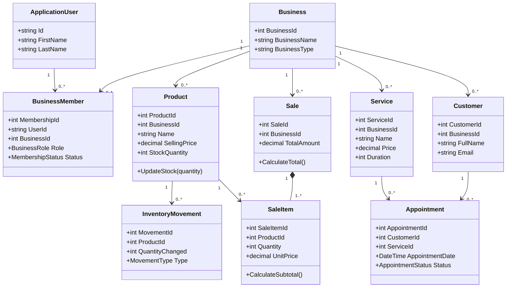

# SmallBiz IQ – UML Class Diagram and Entity Design

**Version:** 0.1  
**Project:** SmallBiz IQ  
**Status:** Initial Design

## 1. Introduction

This document describes the proposed object-oriented design of SmallBiz IQ.

It identifies the main classes, their responsibilities, properties and relationships.

The purpose of this design is to establish a clear structure for the C# application before implementation begins.

## 2. Object-Oriented Design Approach

SmallBiz IQ will use object-oriented programming (OOP).

The system will represent important business concepts through classes and objects.

A class defines the structure and behavior of an object. Properties represent information, while methods represent operations or behavior.

The design will prioritize:

- Encapsulation
- Separation of responsibilities
- Reusability
- Maintainability
- Extensibility

## 3. Main Classes

### 3.1 ApplicationUser

Represents an individual user account.

This class will extend ASP.NET Core Identity's `IdentityUser` to provide authentication and account-management functionality.

Responsibilities:

- Represent an individual account.
- Store basic user profile information.
- Connect users to businesses through memberships.

### 3.2 Business

Represents a registered business.

Responsibilities:

- Store business information.
- Identify the type of business.
- Connect the business to its members and business records.

### 3.3 BusinessMember

Connects a user to a business and defines the user's role and membership status.

Responsibilities:

- Establish business membership.
- Store the assigned role.
- Support role-based authorization.
- Track membership status.

Proposed roles:

- Owner
- Employee
- Receptionist
- Accountant

### 3.4 Product

Represents a product offered by a product-based business.

Responsibilities:

- Store product information.
- Maintain its current selling price and stock quantity.
- Support product-related stock operations.

### 3.5 InventoryMovement

Represents a change in product stock.

Responsibilities:

- Record stock additions.
- Record stock reductions.
- Record manual adjustments.
- Record damaged or wasted stock.

### 3.6 Sale

Represents a completed or recorded sales transaction.

Responsibilities:

- Identify the business associated with the sale.
- Contain sale items.
- Calculate the transaction total.
- Preserve the transaction date.

### 3.7 SaleItem

Represents an individual product included in a sale.

Responsibilities:

- Reference the product sold.
- Store the quantity sold.
- Preserve the unit price at the time of sale.
- Calculate the item's subtotal.

### 3.8 Service

Represents a service offered by a service-based business.

Responsibilities:

- Store service information.
- Define the service price.
- Define the estimated duration.
- Indicate whether the service is available.

### 3.9 Customer

Represents a customer registered by a business.

Responsibilities:

- Store customer contact information.
- Connect customers to their sales or appointments where applicable.

### 3.10 Appointment

Represents a customer booking for a service.

Responsibilities:

- Identify the customer.
- Identify the requested service.
- Store appointment date and time.
- Track appointment status.
- Optionally identify the assigned employee.

## 4. Enumerations

Enumerations will be used to represent predefined sets of values.

Proposed enumerations include:

**BusinessRole**
- Owner
- Employee
- Receptionist
- Accountant

**MembershipStatus**
- Active
- Pending
- Suspended

**MovementType**
- StockAddition
- SaleReduction
- Adjustment
- Waste

**AppointmentStatus**
- Pending
- Confirmed
- Completed
- Cancelled
- NoShow

Using enumerations helps avoid inconsistent values being entered throughout the application.

## 5. Class Relationships

The proposed class relationships are:

- One ApplicationUser can have multiple BusinessMember records.
- One Business can have multiple BusinessMember records.
- One Business can have multiple Products.
- One Product can have multiple InventoryMovements.
- One Business can have multiple Sales.
- One Sale contains one or more SaleItems.
- One Product can appear in multiple SaleItems.
- One Business can offer multiple Services.
- One Business can register multiple Customers.
- One Customer can have multiple Appointments.
- One Service can be associated with multiple Appointments.

These relationships will be implemented through Entity Framework Core navigation properties and foreign keys.

## 6. UML Class Diagram

The UML class diagram is provided in the following conceptual representation:

## 7. Separation of Responsibilities

The system will not place all application operations inside entity classes.

Different components will have different responsibilities:

- **Entities:** Represent business concepts and maintain relevant business rules.
- **Services:** Coordinate application operations and business workflows.
- **Controllers:** Receive and process HTTP requests.
- **Views:** Present information to users.
- **ApplicationDbContext:** Provides database access through Entity Framework Core.

This separation will help keep the code organized and maintainable.

## 8. Future Extensions

The class structure may be extended to support:

- Advanced employee permissions.
- Multiple business branches.
- Expense management.
- Customer-facing ordering.
- Advanced appointment scheduling.
- Analytics and forecasting.
- Notifications and external integrations.

## 9. Conclusion

The proposed class design establishes the object-oriented foundation of SmallBiz IQ.

It represents the main business concepts and their relationships while maintaining a clear separation of responsibilities.

The design will guide the implementation of the domain entities and application services in C#.