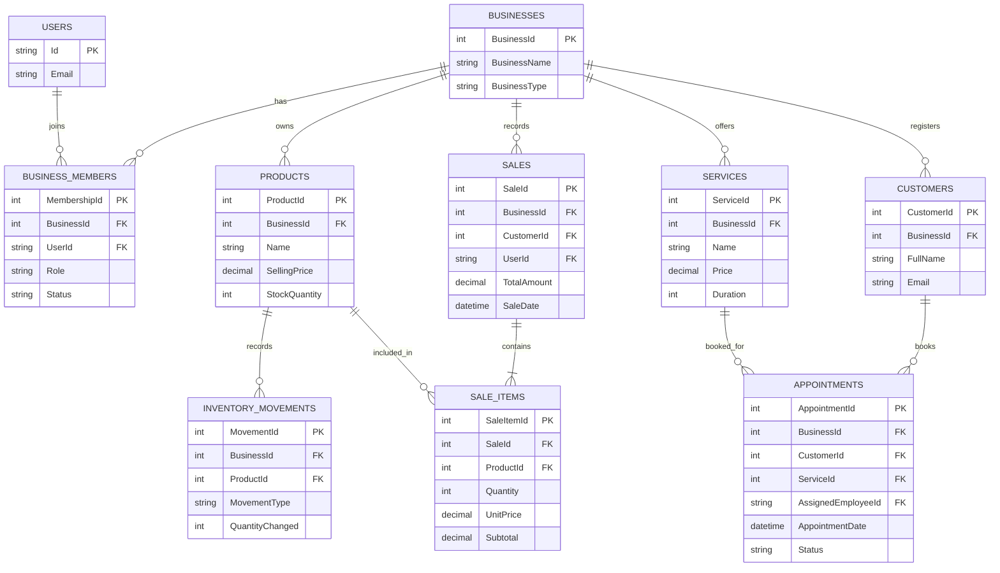

# SmallBiz IQ – Database Design Document

**Version:** 0.1  
**Project:** SmallBiz IQ  
**Status:** Initial Design

## 1. Introduction

This document describes the proposed database structure for SmallBiz IQ. The database will store and organize information about users, businesses, products, services, sales, inventory and customer appointments.

The database design must support different types of small businesses while maintaining data consistency, security and flexibility.

The initial implementation will use SQLite with Entity Framework Core. PostgreSQL may be considered as a future database option.

## 2. Database Design Objectives

The database should:

- Support multiple businesses within one application.
- Allow multiple users to work within the same business.
- Support different business types, including product-based and service-based businesses.
- Maintain relationships between related records.
- Protect business information from unauthorized access.
- Preserve historical transaction information.
- Support future analytics and reporting features.
- Allow the system to expand without requiring a complete redesign.

## 3. Database Approach

SmallBiz IQ will use a relational database model.

A relational database organizes information into tables connected through relationships.

Each table will have a primary key to identify its records. Foreign keys will establish relationships between tables.

The system will use Entity Framework Core (EF Core) to interact with the database through C# objects rather than requiring every database operation to be written manually in SQL.

## 4. Main Database Entities

### 4.1 User

Represents an individual account that can access SmallBiz IQ.

Authentication and password management will be handled through ASP.NET Core Identity rather than implementing password storage and authentication from scratch.

Proposed information:

- User ID (Primary Key)
- Email
- Password hash (managed by Identity)
- First name
- Last name
- Account creation date

### 4.2 Business

Represents a business registered on the platform.

Proposed information:

- Business ID (Primary Key)
- Business name
- Business type
- Description
- Address
- Contact information
- Creation date

The business type may distinguish between product-based, service-based or mixed businesses.

### 4.3 BusinessMember

Connects users to businesses and defines their permissions within each business.

This table supports the multi-user business account approach.

Proposed information:

- Membership ID (Primary Key)
- Business ID (Foreign Key)
- User ID (Foreign Key)
- Role
- Membership status
- Date joined

Possible roles include:

- Owner
- Employee
- Receptionist
- Accountant

The owner will have administrative permissions. Other users will receive permissions according to their assigned roles.

A user-business membership should be unique, so the same user cannot accidentally be added twice to the same business.

### 4.4 Product

Represents an item sold by a product-based business.

Proposed information:

- Product ID (Primary Key)
- Business ID (Foreign Key)
- Product name
- Description
- Selling price
- Stock quantity
- Category
- Creation date

Each product belongs to one business.

Example:

A crepe business may register products such as:

- Chocolate crepe
- Strawberry crepe
- Banana crepe

### 4.5 InventoryMovement

Records changes to product inventory.

Proposed information:

- Movement ID (Primary Key)
- Business ID (Foreign Key)
- Product ID (Foreign Key)
- Movement type
- Quantity changed
- Movement date
- Reason
- User ID (Foreign Key, where applicable)

Movement types may include:

- Stock addition
- Sale reduction
- Manual adjustment
- Damaged or wasted stock

The Product table will store the current stock quantity for convenient access. Inventory movements will provide a history of how that quantity changed.

Both the current stock quantity and the corresponding movement record must be updated consistently.

### 4.6 Sale

Represents a sales transaction.

Proposed information:

- Sale ID (Primary Key)
- Business ID (Foreign Key)
- Customer ID (Foreign Key, optional)
- User ID (Foreign Key, recording the user who created the sale)
- Total amount
- Sale date
- Payment method

A sale belongs to one business and may contain multiple sale items.

### 4.7 SaleItem

Represents an individual product included in a sale.

Proposed information:

- Sale Item ID (Primary Key)
- Sale ID (Foreign Key)
- Product ID (Foreign Key)
- Quantity
- Unit price at the time of sale
- Subtotal

The unit price must be saved when the sale is recorded. This ensures that changing a product's current selling price does not modify historical sales.

The subtotal is calculated from the quantity and unit price.

### 4.8 Service

Represents a service offered by a service-based business.

Proposed information:

- Service ID (Primary Key)
- Business ID (Foreign Key)
- Service name
- Description
- Price
- Duration
- Availability status

Example services offered by a hair salon:

- Knotless braids
- Box braids
- Cornrows
- Wig installation

### 4.9 Customer

Represents a customer associated with a particular business.

Proposed information:

- Customer ID (Primary Key)
- Business ID (Foreign Key)
- Full name
- Email
- Phone number
- Creation date

Customer information will be associated with the relevant business. The same person may therefore have separate customer records at different businesses.

### 4.10 Appointment

Represents a customer booking for a service.

Proposed information:

- Appointment ID (Primary Key)
- Business ID (Foreign Key)
- Customer ID (Foreign Key)
- Service ID (Foreign Key)
- Assigned employee ID (optional)
- Appointment date and time
- Duration
- Price at the time of booking
- Appointment status
- Creation date

Possible appointment statuses include:

- Pending
- Confirmed
- Completed
- Cancelled
- No-show

The price at the time of booking will be preserved even if the service price changes later.

## 5. Entity Relationships

The main relationships are:

- One business can have multiple members.
- One user can have memberships in multiple businesses.
- One business can have multiple products.
- One product can have multiple inventory movements.
- One business can have multiple sales.
- One sale can contain multiple sale items.
- One product can appear in multiple sale items.
- One business can offer multiple services.
- One business can have multiple customers.
- One customer can have multiple appointments.
- One service can be included in multiple appointments.
- One employee can be assigned to multiple appointments.

The following diagram presents the conceptual database structure.

The diagram represents the conceptual model. Exact database types, constraints and implementation details will be refined during development.

## 6. Multi-Tenant Data Organization

SmallBiz IQ will follow a multi-tenant data organization approach.

A tenant represents an individual business using the platform.

Business-owned records will include a Business ID so that the application can identify which business owns each record.

For example:

- Business A must only access its own products.
- Business B must only access its own sales.
- An employee must only access information permitted by their role within their business.

The application must verify business membership and permissions on the server before allowing access to business data.

Filtering information in the user interface alone is not sufficient protection.

Where appropriate, database constraints will also be used to prevent records from being connected across different businesses.

## 7. Data Integrity and Constraints

The following rules will guide database implementation:

1. Every primary key must uniquely identify a record.
2. Foreign keys must reference existing records.
3. Product prices and service prices must not be negative.
4. Product stock quantities must not become negative through an ordinary sale.
5. A sale must contain at least one sale item.
6. A sale item must reference a valid product belonging to the same business as the sale.
7. An appointment must reference a valid customer and service belonging to the same business.
8. A business membership must not be duplicated for the same user and business.
9. Historical transaction prices must not change when current catalogue prices are updated.
10. Sale creation and inventory updates must be handled consistently, preferably within a database transaction.

## 8. Initial Implementation Scope

The database will be implemented progressively.

The first implementation stage will focus on:

- User authentication
- Business registration
- Business membership and owner role
- Product management
- Basic sales recording
- Sale item management
- Basic inventory updates

The following features will be introduced in later stages:

- Employee invitations and advanced role permissions
- Inventory movement history
- Customer management
- Service management
- Appointment management
- Expense tracking
- Advanced analytics and reporting

This staged approach will make the project easier to understand, implement and test.

## 9. Future Considerations

The database structure should allow future improvements, including:

- PostgreSQL support
- More advanced employee permissions
- Multiple branches or business locations
- Expense and profit tracking
- Customer-facing ordering and booking
- Demand forecasting
- Advanced business analytics

These features will be considered when their implementation becomes necessary.

## 10. Conclusion

The proposed database structure provides a foundation for SmallBiz IQ as a multi-business management and decision-support platform.

It supports both product-based and service-based businesses while allowing multiple users to work within individual business accounts.

The design prioritizes data integrity, business data separation, historical accuracy and future extensibility.

The database will be implemented incrementally using Entity Framework Core and SQLite.