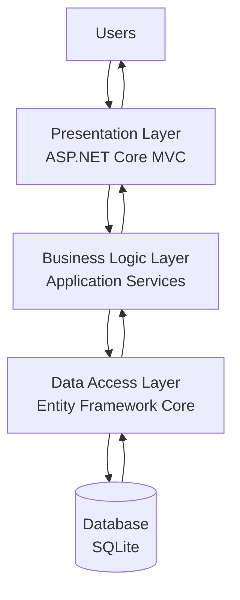

# SmallBiz IQ
## System Architecture Document

**Document:** System Architecture  
**Version:** 0.1  
**Status:** Initial Draft  
**Project Phase:** System Design

---

## 1. Introduction

This document describes the proposed software architecture of SmallBiz IQ.

The purpose of system architecture is to define the main components of the application, their responsibilities, and the relationships between them.

SmallBiz IQ will initially follow a layered, modular monolithic architecture using ASP.NET Core MVC.

This approach will provide a structured foundation for development while avoiding the unnecessary complexity of distributed services during the initial stages.

## 2. Architectural Approach

The proposed architecture combines the following principles:

- Separation of responsibilities.
- Modular organization of application features.
- Reusability of business logic.
- Maintainability and testability.
- Secure access to business information.
- Extensibility for future functionality.

The initial application will be deployed as a single web application, with its internal components organized into separate projects and modules as development progresses.

## 3. Architectural Layers

The application will be organized into four main layers.

### 3.1 Presentation Layer

The Presentation Layer provides the interface through which users interact with SmallBiz IQ.

Its responsibilities include:

- Displaying application pages.
- Receiving user input.
- Handling HTTP requests.
- Returning appropriate responses.
- Displaying validation messages and results.

The presentation layer will use ASP.NET Core MVC, including Controllers and Views.

### 3.2 Business Logic Layer

The Business Logic Layer contains the operations and rules that govern application behaviour.

Its responsibilities include:

- Processing business operations.
- Validating business rules.
- Calculating transaction totals.
- Managing inventory operations.
- Processing appointment operations.
- Calculating analytical indicators.
- Generating basic recommendations.
- Enforcing relevant authorization rules through the application's security mechanisms.

Business logic will be organized into service classes.

### 3.3 Data Access Layer

The Data Access Layer manages communication between application logic and the database.

Entity Framework Core will be used as the primary Object-Relational Mapper (ORM).

Its responsibilities include:

- Retrieving stored information.
- Creating and updating records.
- Deleting records when permitted.
- Managing database transactions.
- Supporting database migrations.
- Maintaining data consistency.

### 3.4 Database Layer

The Database Layer stores the information required by the application.

SQLite will be used as the initial relational database.

The database will eventually store:

- User accounts.
- Business profiles.
- Business memberships and roles.
- Products and services.
- Inventory records.
- Sales transactions.
- Appointments.
- Expenses.
- Other operational information.

PostgreSQL may be considered as a future database option.

## 4. High-Level Architecture Diagram

The diagram illustrates the main flow of information through the application and the return of responses to users.

## 5. Proposed Solution Structure

The solution will progressively be organized into the following projects:

### 5.1 SmallBizIQ.Web

Responsible for the presentation layer.

Contains:

- MVC Controllers.
- Views.
- Static files.
- Application configuration.
- HTTP request handling.

### 5.2 SmallBizIQ.Application

Responsible for application use cases and business operations.

Contains:

- Application services.
- Service interfaces.
- Data Transfer Objects (DTOs).
- Application-level validation and coordination.

### 5.3 SmallBizIQ.Domain

Responsible for the core business model.

Contains:

- Business entities.
- Domain rules.
- Enumerations.
- Core business concepts.

### 5.4 SmallBizIQ.Infrastructure

Responsible for technical infrastructure.

Contains:

- Entity Framework Core configuration.
- Database context.
- Database migrations.
- Data access implementations.
- External technical integrations when required.

The exact project dependencies and folder organization will be refined during implementation.

## 6. Multi-Tenant Architecture Considerations

SmallBiz IQ is intended to support multiple businesses within the same application.

Each business must have its own logically separated information.

The architecture will therefore associate business-owned records with a BusinessId.

The application will verify business membership and user permissions before providing access to protected business information.

The planned user model will support:

- Individual user accounts.
- Business ownership.
- Employee membership.
- Role assignments.
- Permission-based access.

This approach will help prevent unauthorized access between businesses.

## 7. Security Considerations

Security will be incorporated throughout the architecture.

The main principles include:

- Secure authentication.
- Password hashing.
- Authorization checks.
- Business-level data isolation.
- Server-side validation.
- Secure management of application secrets.
- Appropriate error handling.

Security controls will be implemented and tested as the relevant features are developed.

## 8. Architectural Scalability and Extensibility

The architecture should support future additions without requiring a complete redesign.

Potential extensions include:

- Additional business categories.
- Employee management.
- Customer-facing functionality.
- Advanced analytics.
- Predictive models.
- Additional database technologies.
- External integrations.

The modular architecture will allow these capabilities to be introduced progressively.

## 9. Conclusion

The proposed architecture establishes a structured technical foundation for SmallBiz IQ.

The layered modular monolithic approach will separate presentation, business logic, data access, and database responsibilities.

This architecture is intended to support maintainability, testability, security, and future expansion while keeping the initial implementation manageable.